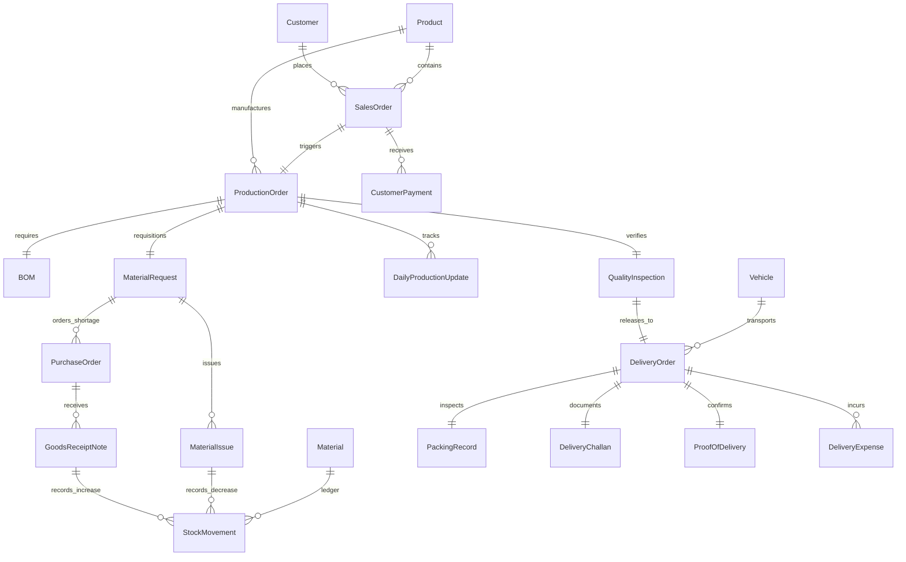

# Cryo Enterprise ERP – Database Schema & Architecture

## 1. Overview & Data Model Design

The Cryo Enterprise ERP backend uses MongoDB with Mongoose ODM in Node.js (ES Modules). The data model adheres to enterprise accounting and manufacturing standards:

- **Primary Collections**: 24 distinct business entity collections.
- **Atomic Counters**: Dedicated `counters` collection managing concurrency-safe auto-incrementing serial codes (`SO-001`, `PRO-001`, `GRN-001`, `PO-001`, etc.) preventing document number collisions.
- **Inventory Invariants**:
  - `Material.currentStock` strictly tracks physical warehouse inventory.
  - PO creation does **not** change inventory.
  - GRN acceptance increments inventory atomically.
  - Material Issue decrements inventory atomically and generates an immutable `StockMovement` ledger entry.
  - Production Material Receipt confirms shopfloor handover without duplicate deductions.
- **Precision Currency**: Order values, payments, unit prices, and expenses are stored as clean decimal numbers without floating point rounding artifacts.

---

## 2. Entity Relationship Diagram (ERD)

---

## 3. Collections Specification

### 3.1 Master Data Collections
| Collection | Primary Key | Key Fields | Indexes |
|---|---|---|---|
| `customers` | `code` (e.g. CUST-001) | `name`, `contactPerson`, `phone`, `email`, `city`, `address`, `gstin`, `creditLimit`, `status` | `{ code: 1 }` (unique), Text index: `{ name, city }` |
| `products` | `code` (e.g. PRD-001) | `sku`, `name`, `model`, `category`, `price`, `description`, `specifications`, `status` | `{ code: 1 }`, `{ sku: 1 }`, Text index: `{ name, model }` |
| `materials` | `code` (e.g. RM-101) | `name`, `unit`, `currentStock`, `allocatedStock`, `minStock`, `unitPrice`, `spec`, `category` | `{ code: 1 }` (unique) |
| `suppliers` | `code` (e.g. SUP-01) | `name`, `contactPerson`, `phone`, `email`, `city`, `address`, `gstin`, `materialsSupplied` | `{ code: 1 }` (unique) |
| `vehicles` | `code` (e.g. VEH-01) | `regNumber`, `vehicleType`, `capacity`, `driverName`, `driverPhone`, `status` | `{ code: 1 }`, `{ regNumber: 1 }` (unique) |
| `courier_providers` | `code` (e.g. PROV-01) | `name`, `serviceType`, `phone`, `contactPerson`, `trackingUrlTemplate`, `status` | `{ code: 1 }` (unique) |

### 3.2 Authentication & Employee Collections
| Collection | Key Fields | Description |
|---|---|---|
| `useraccounts` | `username`, `email`, `passwordHash`, `employeeId`, `role`, `isAdmin`, `departments`, `permissions`, `refreshTokenHash` | JWT Auth & RBAC |
| `employees` | `code` (EMP-xxx), `name`, `email`, `phone`, `designation`, `department`, `joinedDate`, `status` | Employee directory |
| `departments` | `code` (sales, production, etc.), `name`, `headOfDepartment`, `activeEmployeeCount`, `status` | Department structure |
| `roles` | `code`, `name`, `department`, `permissions: { view, create, edit, workflow }` | Role templates |
| `auditlogs` | `action`, `department`, `resource`, `resourceId`, `userId`, `userName`, `details`, `ipAddress`, `createdAt` | Immutable activity trail |

### 3.3 Sales & Customer Orders Collections
| Collection | Key Fields | Workflow Relationships |
|---|---|---|
| `enquiries` | `code` (ENQ-xxx), `customerName`, `productName`, `quantity`, `budget`, `source`, `status`, `followUps` | Stages 1-3 |
| `quotations` | `code` (QT-xxx), `version`, `enquiryCode`, `customerName`, `quantity`, `unitPrice`, `totalAmount`, `status` | Stages 4-8 (Supports negotiation v1->v2) |
| `proformainvoices` | `code` (PI-xxx), `quotationCode`, `customerName`, `totalAmount`, `advanceRequired`, `balanceDue` | Stage 9 |
| `customerpurchaseorders`| `code` (CPO-xxx), `cpoNumber`, `quotationCode`, `customerName`, `orderValue`, `status` | Stage 10 |
| `salesorders` | `code` (SO-xxx), `enquiryCode`, `quotationCode`, `cpoNumber`, `customerName`, `productName`, `quantity`, `unitPrice`, `orderValue`, `receivedAmount`, `balanceAmount`, `paymentArrangement`, `paymentStatus`, `status`, `completedStageNum` | Stage 12 (Central entity through Stage 22) |
| `customerpayments` | `code` (PAY-xxx), `salesOrderCode`, `customerName`, `paymentType`, `amount`, `paymentMode`, `referenceNumber`, `status` | Stages 11 & 22 |

### 3.4 Production & Assembly Collections
| Collection | Key Fields | Description |
|---|---|---|
| `productionorders` | `code` (PRO-xxx), `salesOrderCode`, `productCode`, `quantity`, `bomCode`, `status`, `progress`, `startDate`, `completedDate` | Stage 13-20 |
| `boms` | `code` (BOM-xxx), `productionOrderCode`, `productCode`, `items: [{ materialCode, materialName, quantityPerUnit, totalQuantity }]`, `confirmed` | Stage 13 |
| `materialrequests` | `code` (MR-xxx), `productionOrderCode`, `requestedBy`, `items: [{ materialCode, requiredQty, issuedQty }]`, `status` | Stage 14 |
| `materialreceipts` | `code` (RCPT-xxx), `productionOrderCode`, `materialRequestCode`, `receivedBy`, `items: [{ materialCode, quantityReceived }]` | Stage 18 (Shopfloor confirmation) |
| `dailyproductionupdates`| `productionOrderCode`, `date`, `shift`, `stageName`, `progressPercentage`, `operatorName`, `notes` | Stage 19 |
| `qualityinspections` | `code` (QC-xxx), `productionOrderCode`, `productCode`, `inspectedQuantity`, `testedParameters`, `result`, `inspectorName` | Stage 20 |

### 3.5 Supply Chain & Warehouse Collections
| Collection | Key Fields | Description |
|---|---|---|
| `purchaseorders` | `code` (PO-xxx), `supplierCode`, `materialRequestCode`, `items: [{ materialCode, quantity, unitPrice, totalPrice }]`, `totalAmount`, `status` | Stage 16 (Does not touch stock) |
| `goodsreceiptnotes` | `code` (GRN-xxx), `purchaseOrderCode`, `supplierCode`, `items: [{ materialCode, receivedQty, acceptedQty }]`, `status` | Stage 17 (Increments stock atomically) |
| `materialissues` | `code` (MI-xxx), `materialRequestCode`, `issueType`, `items: [{ materialCode, quantityIssued }]`, `issuedBy`, `status` | Stages 15 & 18 (Decrements stock atomically) |
| `stockmovements` | `materialCode`, `movementType` (GRN/ISSUE/ADJ), `quantity`, `balanceAfter`, `referenceDoc`, `performedBy` | Immutable inventory ledger |
| `stockadjustments` | `code` (ADJ-xxx), `materialCode`, `previousStock`, `adjustedStock`, `variance`, `reason`, `authorizedBy` | Physical audit variance corrections |

### 3.6 Logistics & Delivery Collections
| Collection | Key Fields | Description |
|---|---|---|
| `deliveryorders` | `code` (DEL-xxx), `salesOrderCode`, `customerName`, `destinationAddress`, `deliveryMethod`, `vehicleCode`, `driverName`, `status`, `balancePaymentDue`, `balancePaymentCollected` | Stage 21-22 |
| `packingrecords` | `code` (PKG-xxx), `deliveryOrderCode`, `packingType`, `packageCount`, `checklist`, `checkedBy`, `status` | Stage 21 |
| `deliverychallans` | `code` (DC-xxx), `deliveryOrderCode`, `salesOrderCode`, `customerName`, `vehicleRegNumber`, `items`, `issuedBy` | Stage 21 |
| `proofofdeliveries`| `code` (POD-xxx), `deliveryOrderCode`, `salesOrderCode`, `receivedByCustomer`, `balanceCollected`, `paymentMode`, `signedSignatureData` | Stage 22 |
| `deliveryexpenses` | `code` (EXP-xxx), `deliveryOrderCode`, `category`, `amount`, `receiptRef`, `paidBy`, `status` | Trip expenses |
